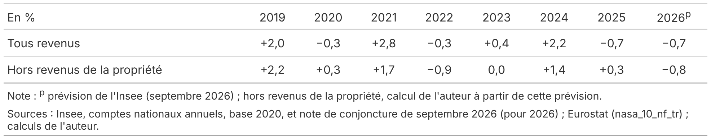
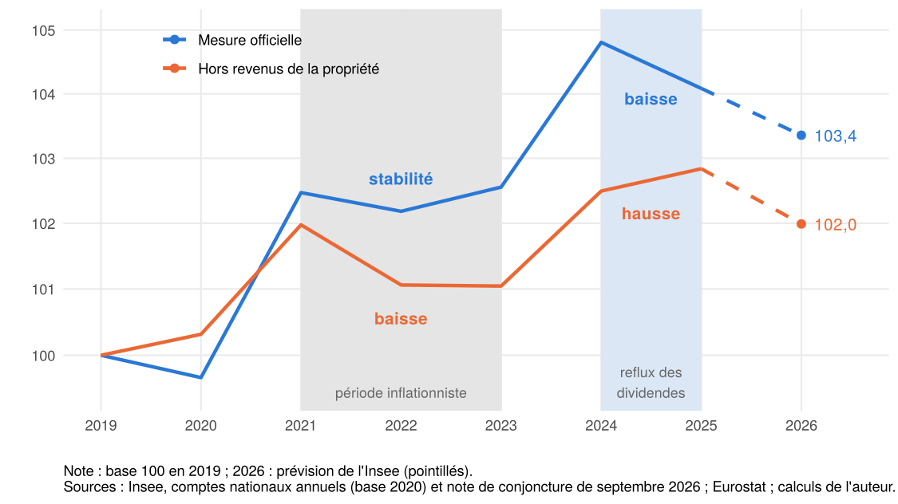

# Pouvoir d'achat : ce que masquent les revenus du patrimoine

Date de publication : 25 novembre 2026.

Ce dépôt met à disposition les codes de réplication du billet « [Pouvoir d'achat : ce que masquent les revenus du patrimoine](https://www.ofce.fr/blog2024/fr/2026/20261125_FG/) » (Blog de l'IFE-OFCE, 25 novembre 2026), repris avec sa présentation sur [fgeerolf.com](https://fgeerolf.com/pouvoir-achat-2025.html).

  <!-- Reader Navigation -->
  **[📝 Billet (Blog de l'IFE-OFCE)](https://www.ofce.fr/blog2024/fr/2026/20261125_FG/)** •
  **[📖 Version en ligne](https://fgeerolf.com/pouvoir-achat-2025.html)** •
  **[📄 Version PDF](https://fgeerolf.com/pouvoir-achat-2025.pdf)** •
  **[🌐 Présentation HTML](https://fgeerolf.com/pouvoir-achat-2025-handouts.html)** •
  **[📓 Présentation PDF](https://fgeerolf.com/pouvoir-achat-2025-slides.pdf)**

## Réplication

Les scripts s'exécutent depuis la racine du dépôt (ouvrir `pouvoir-achat-2025.Rproj`). Ils téléchargent directement les données de l'Insee et d'Eurostat : il n'y a rien à installer d'autre que les paquets R (`readxl`, `ggplot2`, `scales`, `gt`).

[`R/donnees.R`](R/donnees.R), appelé par les autres scripts, rassemble les données et les écrit dans `data.csv` :

- Eurostat, comptes non financiers des ménages, `nasa_10_nf_tr` (secteur S14, France) : revenu disponible brut, revenus de la propriété, intérêts avant et après répartition des SIFIM (`D41G`, `D41`) ;
- Insee, comptes nationaux annuels, base 2020 (mai 2026), dépense de consommation des ménages par produit aux niveaux les plus fins : consommation de SIFIM (« services financiers de prêts et dépôts implicitement mesurés ») en valeur et en volume, qui donne le prix de la consommation hors SIFIM ;
- Insee, pouvoir d'achat du revenu disponible brut et nombre d'unités de consommation.

La mesure « tous revenus » est celle que publie l'Insee, sur l'ensemble du revenu disponible. Le pouvoir d'achat hors revenus de la propriété est le revenu disponible hors SIFIM, diminué des revenus nets de la propriété effectivement reçus (intérêts hors SIFIM, dividendes, revenus de l'assurance-vie, loyers des terrains), déflaté par le prix de la consommation hors SIFIM et rapporté au nombre d'unités de consommation. La prévision pour 2026 reprend celle de la note de conjoncture de l'Insee de septembre 2026 ([`R/prevision2026.R`](R/prevision2026.R)).

### Tableau 1 : Évolution annuelle du pouvoir d'achat par unité de consommation, avec et sans les revenus de la propriété

[Code R](R/table1.R)

### Graphique 1 : Évolution du pouvoir d'achat par unité de consommation, avec et sans les revenus de la propriété, base 100 en 2019

[Code R](R/figure1.R)

### Données du tableau et du graphique

Les scripts écrivent aussi les données dans [`csv/table1.csv`](csv/table1.csv) (évolutions annuelles en %, deux décimales) et [`csv/figure1.csv`](csv/figure1.csv) (indices base 100 en 2019). La [version en ligne](https://fgeerolf.com/pouvoir-achat-2025.html) lit directement le tableau et le graphique produits par ce dépôt.

### Chiffres cités dans le texte

[Code R](R/chiffres.R) : dans l'ordre du billet, revenus de la propriété et intérêts hors SIFIM, cumul 2021-2023, prévision 2026, variante sans neutraliser les SIFIM, dividendes de 2013 et 2018, cumuls 2019-2026. Chaque chiffre est affiché à côté de la valeur retenue dans le texte.

[Code R](R/distribution.R) : comptes nationaux distribués 2023 (*Insee Analyses* n° 119, avril 2026), part des revenus financiers dans le revenu disponible par dixième de niveau de vie et pouvoir d'achat par cinquième.

## Millésime des données

Les chiffres du billet correspondent aux comptes annuels de l'Insee publiés en mai 2026 (2023 définitif, 2024 semi-définitif, 2025 provisoire) et aux données d'Eurostat de novembre 2026. Les publications ultérieures peuvent modifier légèrement les résultats.
